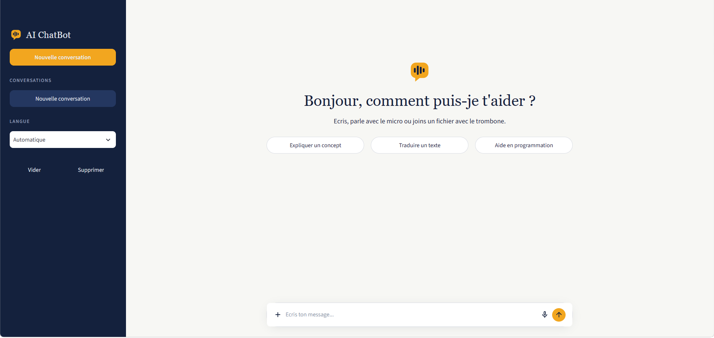
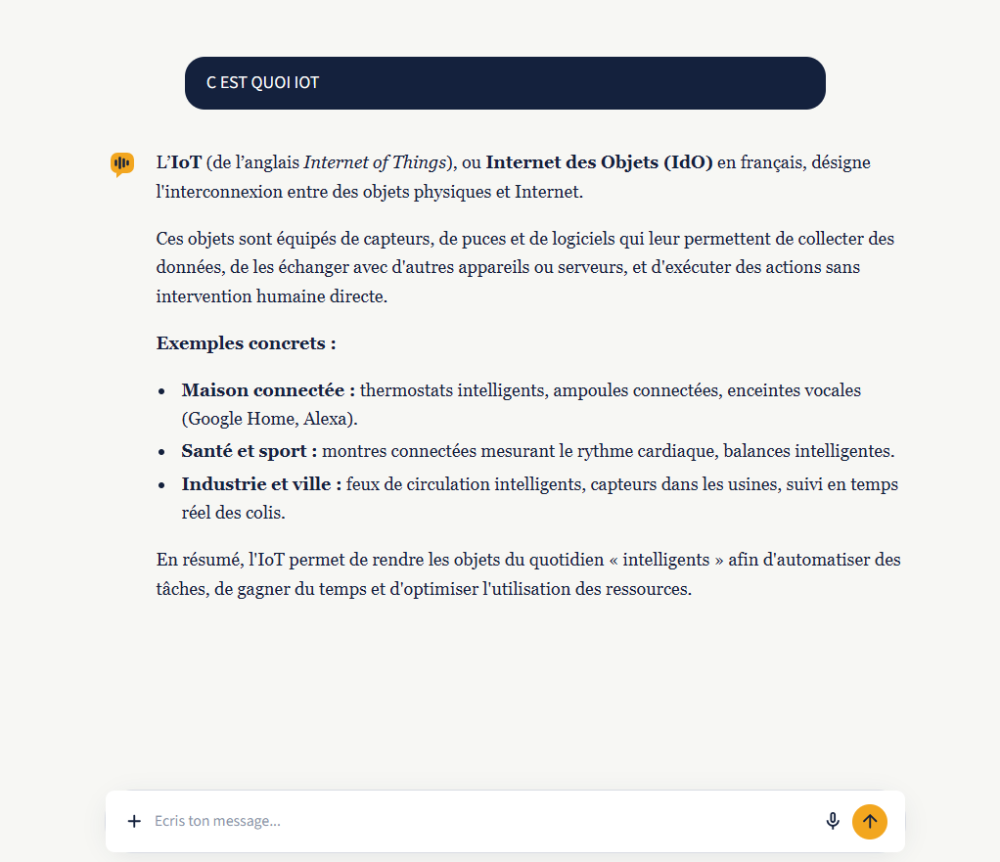
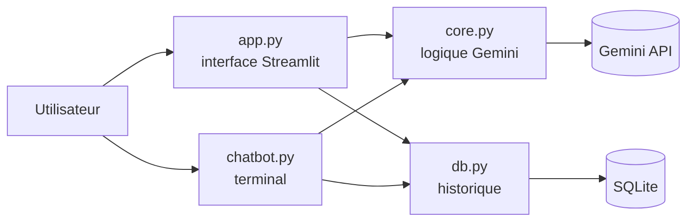

# AI ChatBot

Assistant conversationnel multilingue base sur l'API Gemini, avec interface web Streamlit,
historique des conversations dans SQLite, messages vocaux et envoi de fichiers.


## Apercu

| Page d'accueil | Conversation |
|----------------|--------------|
|  |  |

## Fonctionnalites

- **Multilingue** : detecte la langue de l'utilisateur (francais, arabe, darija, anglais, espagnol, etc.) et repond dans la meme langue ; la langue des reponses peut aussi etre imposee.
- **Conversation avec contexte** : l'historique est renvoye au modele a chaque message.
- **Reponses en streaming** : le texte s'affiche au fur et a mesure.
- **Messages vocaux** : le micro integre a la barre de saisie ; l'audio est transcrit par Gemini puis traite comme un message texte.
- **Envoi de fichiers** : images (png, jpg, webp), PDF et fichiers texte (txt, md, csv, json, py), joints au message.
- **Historique persistant** : plusieurs conversations sauvegardees dans SQLite, avec reprise, vidage et suppression.
- **Fiabilite** : nouvelles tentatives automatiques et modeles de secours quand l'API est surchargee.
- **Deux interfaces** : application web (Streamlit) et version terminal.

## Technologies

| Domaine | Outil |
|---------|-------|
| Langage | Python 3.10+ |
| Modele d'IA | Gemini API (SDK `google-genai`) |
| Interface web | Streamlit |
| Base de donnees | SQLite (module standard `sqlite3`) |
| Configuration | `python-dotenv` |

## Architecture



- `core.py` regroupe tout ce qui concerne Gemini : construction du contexte, streaming, conversion des fichiers, transcription audio, reessais et modeles de secours.
- `db.py` gere la persistance des conversations.
- `app.py` et `chatbot.py` ne contiennent que l'interface et partagent la meme logique.

## Installation

Prerequis : Python 3.10 ou plus et une cle API Gemini gratuite (Google AI Studio).

```bash
git clone https://github.com/Chaymae-El-Bahloul/ai-chatbot.git
cd ai-chatbot
python -m venv venv
```

Activation de l'environnement :

```bash
# Windows (PowerShell)
venv\Scripts\activate
# macOS / Linux
source venv/bin/activate
```

Installation des dependances :

```bash
pip install -r requirements.txt
```

## Configuration

Copie `.env.example` en `.env` puis renseigne ta cle :

```
GEMINI_API_KEY=ta_cle_ici
```

Variables optionnelles :

| Variable | Role | Valeur par defaut |
|----------|------|-------------------|
| `GEMINI_MODEL` | Modele principal | `gemini-3.8-flash` |
| `GEMINI_FALLBACKS` | Modeles de secours, separes par des virgules | `gemini-3.6-flash,gemini-3.5-flash-lite` |
| `CHATBOT_DB` | Chemin du fichier SQLite | `chatbot.db` |

Le fichier `.env` est ignore par Git : la cle ne doit jamais etre publiee.

## Utilisation

### Interface web

```bash
streamlit run app.py
```

L'application s'ouvre sur `http://localhost:8501`.

- Barre laterale : nouvelle conversation, liste des conversations, choix de la langue.
- Barre de saisie : texte, trombone pour joindre des fichiers, micro pour un message vocal.

Le micro n'est disponible que sur `localhost` ou en HTTPS.

### Terminal

```bash
python chatbot.py
```

| Commande | Role |
|----------|------|
| `/help` | Afficher l'aide |
| `/new` | Nouvelle conversation |
| `/history` | Lister les conversations sauvegardees |
| `/open ID` | Reprendre une conversation |
| `/reset` | Effacer les messages de la conversation |
| `/lang X` | Forcer la langue (`/lang auto` pour revenir a la detection) |
| `/file CHEMIN` | Joindre un fichier au prochain message |
| `/quit` | Quitter |

## Structure du projet

```
ai-chatbot/
  app.py               interface web Streamlit
  chatbot.py           version terminal
  core.py              appels a l'API Gemini
  db.py                historique SQLite
  requirements.txt     dependances
  .env.example         modele de configuration
  .streamlit/
    config.toml        theme de l'interface
  docs/
    screenshots/       captures d'ecran du README
  LICENSE
```

## Base de donnees

Deux tables, creees automatiquement au premier lancement :

| Table | Colonnes |
|-------|----------|
| `conversations` | `id`, `title`, `created_at` |
| `messages` | `id`, `conversation_id`, `role` (`user` ou `assistant`), `content`, `created_at` |

La suppression d'une conversation supprime ses messages (`ON DELETE CASCADE`).
Seul le texte est conserve : les fichiers et l'audio ne sont pas stockes.

## Gestion des erreurs de l'API

Quand l'API repond par une erreur temporaire (429, 500, 502, 503, 504), l'application reessaie
puis bascule sur les modeles de secours. Si un modele n'est plus disponible (404), elle passe
directement au suivant. Les autres erreurs, comme une cle invalide, sont affichees immediatement.

## Deploiement

L'application peut etre deployee gratuitement sur Streamlit Community Cloud :

1. Publier le depot sur GitHub.
2. Sur [share.streamlit.io](https://share.streamlit.io), creer une application a partir du depot, avec `app.py` comme fichier principal.
3. Dans **Advanced settings > Secrets**, ajouter :
   ```
   GEMINI_API_KEY = "ta_cle_ici"
   ```

Limites a connaitre : le disque de Streamlit Cloud n'est pas persistant, donc l'historique SQLite
est perdu a chaque redemarrage, et tous les visiteurs partagent la meme base. Pour un usage reel,
il faudrait une base externe et une authentification.

## Pistes d'amelioration

- Authentification des utilisateurs et historique separe par utilisateur
- Base de donnees externe pour un deploiement persistant
- Synthese vocale des reponses
- Export d'une conversation en PDF ou Markdown
- Tests automatises (`pytest`) pour `db.py` et `core.py`

## Auteure

**Chaymae El Bahloul**, etudiante en 2e annee de DUT Ingenierie des donnees a l'EST d'El Kelaa des Sraghna (Universite Cadi Ayyad).

GitHub : [Chaymae-El-Bahloul](https://github.com/Chaymae-El-Bahloul)

## Licence

Projet distribue sous licence MIT. Voir le fichier [LICENSE](LICENSE).
